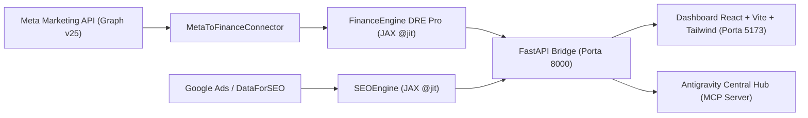

# 🧠💎 Capvi IA — Acelerador de Lucratividade & Inteligência Martech

O **Capvi IA (`projetoseo2`)** é uma plataforma de **Marketing & Financial Intelligence** que une a fundamentação estratégica de **Philip Kotler**, o método **AERM (V4 Company)** e **Growth Hacking** a um motor matemático vetorial em **Google JAX (`@jit`)** e agentes de IA (**Google Gemini** + **MCP Protocol**).

---

## 🏗️ Arquitetura do Sistema



### Principais Motores (`olist-analytics-local/src/`)
- **`FinanceEngine` (DRE Pro Vetorial em JAX):** Simulação em tempo real de Receita Bruta, COGS, Impostos, Frete, Taxa de Marketplace, Margem de Contribuição, **EBITDA Final** e **Ponto de Equilíbrio (Breakeven)** com engenharia reversa de metas.
- **`MetaAdsService` & `MetaToFinanceConnector`:** Integração direta com a **Meta Marketing API** (Facebook/Instagram Ads) convertendo campanhas reais em diagnóstico de lucratividade e recomendações de escala/pausa de criativos.
- **`SEOEngine` & IPM (Índice de Potencial de Mercado):** Classificação vetorial de palavras-chave em **Oceano Azul** (`IPM > 10.000`), **Zona de Crescimento** e **Mercado Maduro**.
- **`GrowthEngine` (Matriz ICE):** Priorização ágil de experimentos de Growth (*Impacto × Confiança × Facilidade*).
- **`RetentionEngine` (CRM & RFM):** Segmentação estatística via Z-score (*Campeões, Leais, Em Risco, Perdidos*) calibrada com base real de e-commerce (**112k pedidos / Ticket Médio R$ 120,65**).

---

## 🚀 Como Executar

### 1. Backend (FastAPI + Motor JAX)
```bash
cd olist-analytics-local
python -m venv .venv
.venv\Scripts\activate
pip install -r requirements.txt
python src/main_api.py
```
> O servidor FastAPI iniciará em `http://127.0.0.1:8000` (ou execute `run_backend.bat` na raiz).

### 2. Frontend (React 18 + Vite + Tailwind CSS)
```bash
cd seo-app
npm install
npm run dev
```
> Acesse a interface em `http://localhost:5173`.

---

## 🔐 Variáveis de Ambiente (`.env`)
Crie seu arquivo `.env` em `olist-analytics-local/.env` e `seo-app/.env` (nunca versionados no Git):

```env
# Meta Marketing API
META_APP_ID=SEU_APP_ID
META_APP_SECRET=SEU_APP_SECRET
META_ACCESS_TOKEN=SEU_ACCESS_TOKEN
META_AD_ACCOUNT_ID=000000000000000

# Google Gemini & DataForSEO (Frontend)
VITE_GEMINI_API_KEY=SUA_CHAVE_GEMINI
VITE_DATAFORSEO_LOGIN=SEU_LOGIN
VITE_DATAFORSEO_PASSWORD=SUA_SENHA
```

---

## 🛠️ Stack Tecnológica
- **Frontend:** React 18, TypeScript, Vite, Tailwind CSS, Lucide Icons
- **Backend & Math Engine:** Python 3.10+, FastAPI, Uvicorn, Google JAX (`jax`, `jaxlib`), Pandas, SQLAlchemy, Supabase
- **Integrações Martech:** Meta Business SDK (`facebook-business`), Google Ads API, DataForSEO, Model Context Protocol (MCP)
