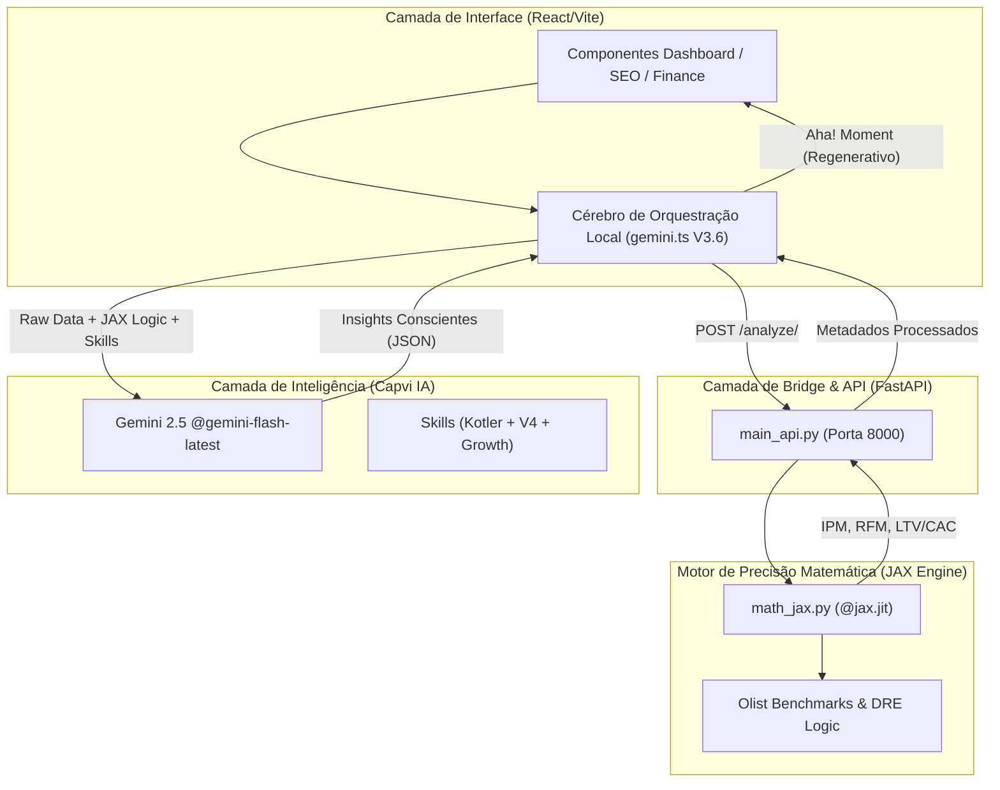

# 🧠 Arquitetura do Cérebro V3.6 — Capvi IA

Este documento descreve o fluxo técnico e a integração entre as camadas de **Cálculo Matemático JAX** e **Inteligência Regenerativa**.

## Fluxo de Dados Consolidado V3.6

A arquitetura segue o princípio: **Dados Brutos -> Metadados JAX -> Insight Consciente**.

## Componentes Chave V3.7

| Componente | Arquivo | Função Relevante |
| :--- | :--- | :--- |
| **Refinaria de Dados** | `colab_jax_refinery.py` | Calibração de benchmarks no Google Colab. |
| **Cérebro de Orquestração Local** | `gemini.ts` | Une dados JAX com o **DNA Regenerativo**. |
| **Bridge API** | `main_api.py` | Faz a ponte entre JS e a matemática JAX. |
| **Motor de Precisão Matemática** | `math_jax.py` | Cálculos de IPM, ICE e RFM de alta performance. |
| **Personalidades & Expertise** | `.agent/skills/` | Define a voz do **Growth Marketing Especialista**. |

---
*Arquivos modificados: gemini.ts, math_jax.py, arquitetura_cerebro.md*
*Atualizado em: 23/03/2026 por Antigravity*

