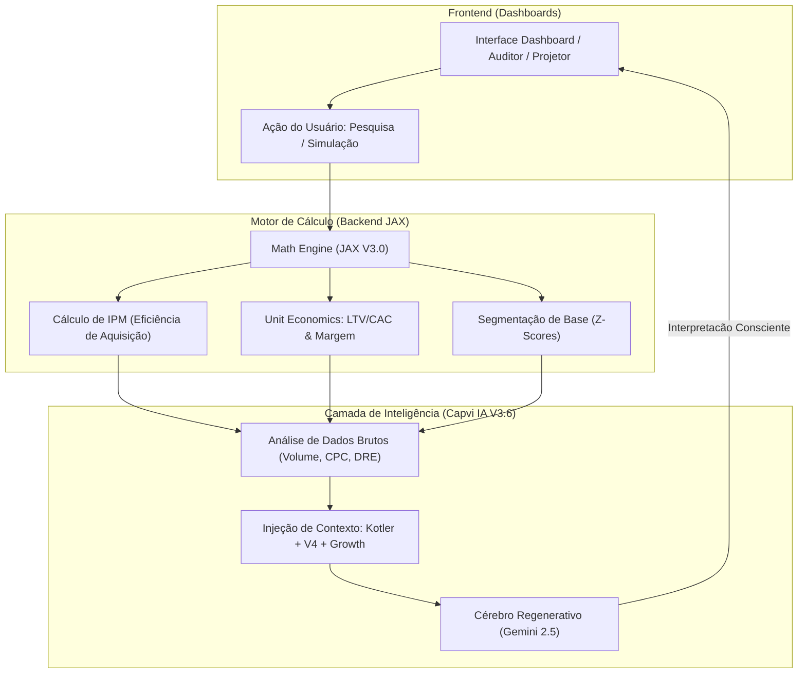

# 🏺 Business Soul & Processes V3.8

Este documento detalha como a visão de negócio e as metodologias de **Growth Hacking** são processadas, desde a refinaria até a interface.

## A "Alma" do Processamento V3.8

A Capvi IA utiliza uma pipeline de 5 fases para garantir precisão e alma:

1.  **Refinaria (Colab):** Calibração inicial com dados reais do Olist BR.
2.  **AERM (V4 Company):** Foco em Aquisição, Engajamento, Retenção e Monetização.
3.  **Marketing Holístico (Kotler):** Foco no valor para o cliente e legado de marca.
4.  **Matemática de Precisão (JAX):** Uso de Z-Scores e RFM para eliminar o achismo.
5.  **Cérebro de Orquestração Local:** A arquitetura que transforma isso em visual.

## Tabela de Componentes de Negócio
...

## Componentes Chave V3.7

| Componente | Arquivo | Função Relevante |
| :--- | :--- | :--- |
| **Cérebro de Orquestração Local** | `gemini.ts` | Une dados JAX com o **DNA Regenerativo**. |
| **Bridge API** | `main_api.py` | Faz a ponte entre JS e a matemática JAX. |
| **Motor de Precisão Matemática** | `math_jax.py` | Cálculos de IPM, ICE e RFM de alta performance. |
| **Personalidades & Expertise** | `.agent/skills/` | Define a voz do **Growth Marketing Especialista**. |

## Tabela de Componentes de Negócio

| Métrica | Local de Cálculo | Regra de Negócio V3.6 (Manual JAX) |
| :--- | :--- | :--- |
| **IPM** | Motor de Precisão Matemática | > 10k: Oceano Azul | 3k-10k: Escala | < 3k: Maduro |
| **LTV/CAC** | Motor de Precisão Matemática | > 3.0: Saudável | > 5.0: Máquina de Lucro | < 3.0: Crítico |
| **ICE Score** | Motor de Precisão Matemática | Impacto x Confiança x Facilidade. Projetos > 700 são prioridade. |
| **RFM / Z-Score** | Motor de Precisão Matemática | Distância do desvio padrão para identificar Clientes Campeões. |

---
*Arquivos modificados: gemini.ts, math_jax.py, business_soul_and_processes.md*
*Atualizado em: 23/03/2026 por Antigravity*
