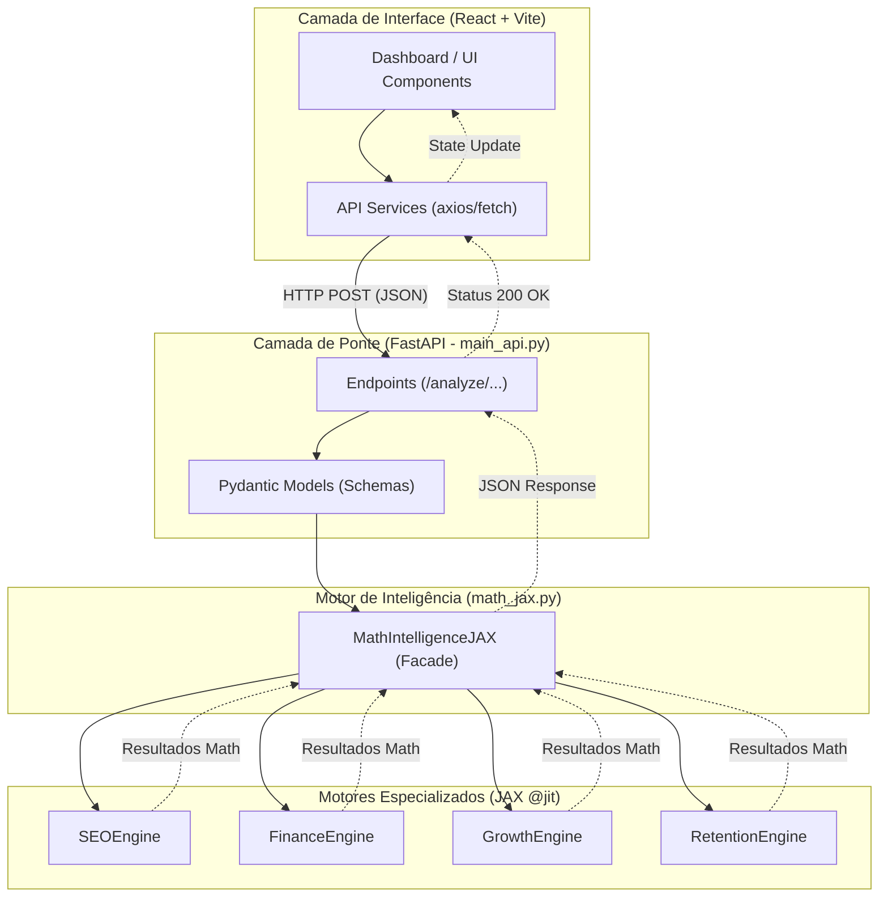

# Capvi SEO: Arquitetura Modular JAX

Esta documentação descreve o funcionamento interno do projeto, desde a interface do usuário até os motores de cálculo de alta performance.

## Diagrama de Fluxo (BPMN 2.0 / Mermaid)

Abaixo, o fluxo de dados seguindo os princípios de Arquitetura Limpa (Global Rule 1 & 2).



---

## Passo a Passo: O Fluxo da Informação

1.  **Entrada (Usuário)**: O usuário interage com um componente no painel (ex: insere uma palavra-chave ou valores de investimento).
2.  **Frontend (Processamento Inicial)**: O componente chama uma função de serviço (ex: `gemini.ts` ou um novo service) que envia os dados via `axios` para o backend Python.
3.  **Backend (Ponte API)**: O `main_api.py` (rodando na porta 8000) recebe a requisição. Ele usa modelos `Pydantic` para garantir que os dados estão no formato correto.
4.  **Facade (Cérebro Central)**: A classe `MathIntelligenceJAX` em `math_jax.py` recebe a chamada. Ela não calcula nada sozinha; ela apenas sabe **quem** deve calcular.
5.  **Motores (Córtex Lógico)**: O motor específico (ex: `FinanceEngine`) processa os números usando a biblioteca `JAX`. O decorador `@jit` garante que esses cálculos sejam compilados e executados em velocidade máxima.
6.  **Resposta**: O resultado volta pelo mesmo caminho até a UI, onde o dashboard é atualizado com novos gráficos e métricas.

---

## Guia: Como criar um Novo Service

Para estender o sistema com uma nova funcionalidade (ex: `InventoryEngine`), siga esta ordem:

### 1. Criar o Motor (`engines/`)
Crie `olist-analytics/src/engines/inventory_engine.py`:
```python
from jax import jit

@jit
def calculate_stock_health(stock, sales):
    return stock / (sales + 1e-9)

class InventoryEngine:
    def analyze_stock(self, stock, sales):
        days = calculate_stock_health(stock, sales)
        return {"days_of_stock": float(days)}
```

### 2. Registrar na Facade (`math_jax.py`)
```python
from engines.inventory_engine import InventoryEngine

class MathIntelligenceJAX:
    def __init__(self):
        # ... outros motores
        self.inventory = InventoryEngine()

    def analyze_inventory(self, stock, sales):
        return self.inventory.analyze_stock(stock, sales)
```

### 3. Expor na API (`main_api.py`)
```python
class InventoryRequest(BaseModel):
    stock: int
    sales: int

@app.post("/analyze/inventory")
def analyze_inventory(data: InventoryRequest):
    return math_engine.analyze_inventory(data.stock, data.sales)
```

---

**Arquivos afetados pela análise:**
- `main_api.py`
- `math_jax.py`
- `engines/finance_engine.py`
- `engines/growth_engine.py`
- `engines/retention_engine.py`
- `engines/seo_engine.py`

**Para visualizar o diagrama**: Copie o bloco Mermaid em `draw.io > Extras > Edit Diagram`.
