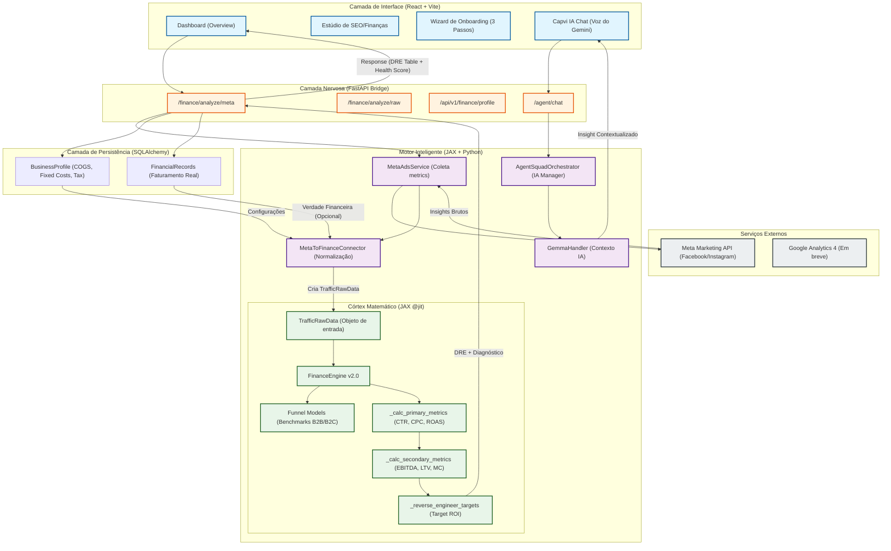

# Ecossistema Capvi SEO — BPMN 2.0 (Mermaid)
Este documento descreve o fluxo completo do ecossistema Capvi SEO, incluindo as atualizações recentes de integração financeira e Meta Ads.

## Diagrama de Fluxo (BPMN)

### Arquivos Afetados e Responsabilidades
1.  **`seo-app/`**: Interface visual e consumo de API.
2.  **`olist-analytics-local/src/main_api.py`**: Orquestrador central e roteamento.
3.  **`olist-analytics-local/src/engines/finance_engine.py`**: Lógica matemática de alta performance (JAX).
4.  **`olist-analytics-local/src/engines/funnel_models.py`**: Definição de benchmarks por tipo de negócio.
5.  **`olist-analytics-local/src/services/meta_ads_service.py`**: Integração com a API da Meta.
6.  **`olist-analytics-local/src/connectors/meta_to_finance_connector.py`**: Ponte entre marketing e financeiro.
7.  **`olist-analytics-local/src/database/`**: Persistência de configurações e histórico.

---
*Gerado automaticamente pelo Agente Capvi conforme GLOBAL RULE 4.*
