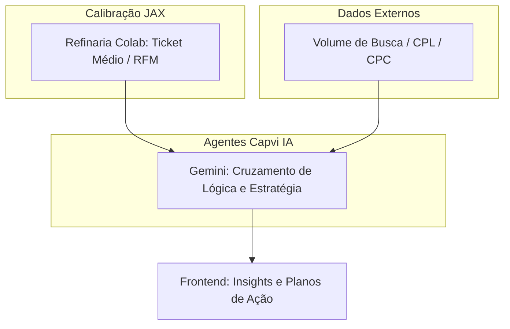

# 🌍 Visão Geral: O Ciclo de Inteligência Capvi SEO

Você acaba de completar a fase de **Calibração do Cérebro**. Aqui está o mapa estratégico de como sua IA utiliza esses dados:

---

## 1. O que fizemos no Colab?
O Colab é o seu **Centro de Calibração**. Lá, processamos 112 mil linhas para dar à IA o que chamamos de **"Dados de Fundação"** (Ticket Médio Real, Categorias Fortes). Sem isso, a IA trabalha com médias genéricas; com isso, ela trabalha com a **sua realidade**.

## 2. Como a IA "Cruza" os Dados?
A magia acontece no encontro de três camadas:
1. **Camada Interna (Sua):** Ticket Médio, RFM, Margens (Vindos da Refinaria).
2. **Camada de Mercado (Externa):** Volume de buscas, CPL, CPC médio (Vindos de ferramentas de SEO).
3. **Camada de Inteligência (IA):** Os agentes interpretam: *"Se o Ticket Médio é R$ 120 e o CPL é R$ 10, sua margem permite escala?"*.

## 3. O Fluxo Digital (BPMN 2.0)

## 4. Onde a IA busca essas regras?
Os agentes (Gemini) buscam as fórmulas matemáticas nos motores JAX (`math_jax.py`) e as diretrizes de marketing nos arquivos de Skill (`SKIIL mkt.md`). Toda vez que você calibra os dados no Colab, você está, na verdade, **ensinando a IA a ser um consultor melhor para o seu negócio.**

---

### 💡 Próxima Missão:
Deseja que eu atualize as **Skills de Marketing** do projeto com esses novos aprendizados (Ticket Médio de R$ 120,65 e as Categorias Top)? Isso fará com que qualquer análise futura da IA já considere esses benchmarks.
